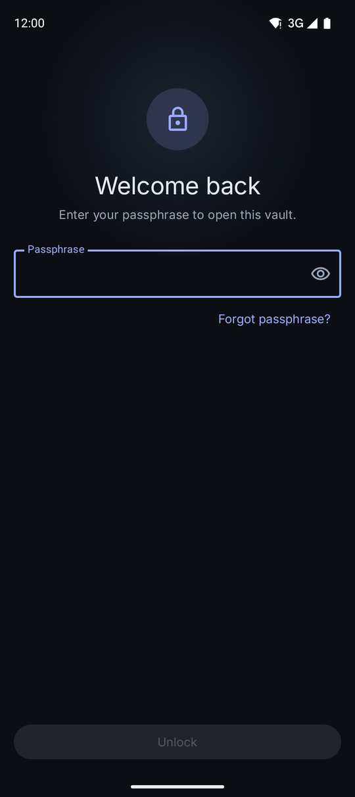
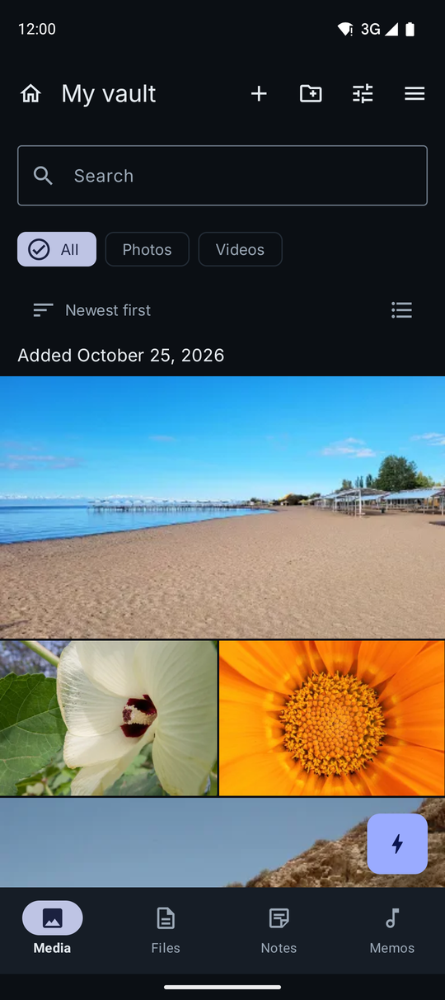
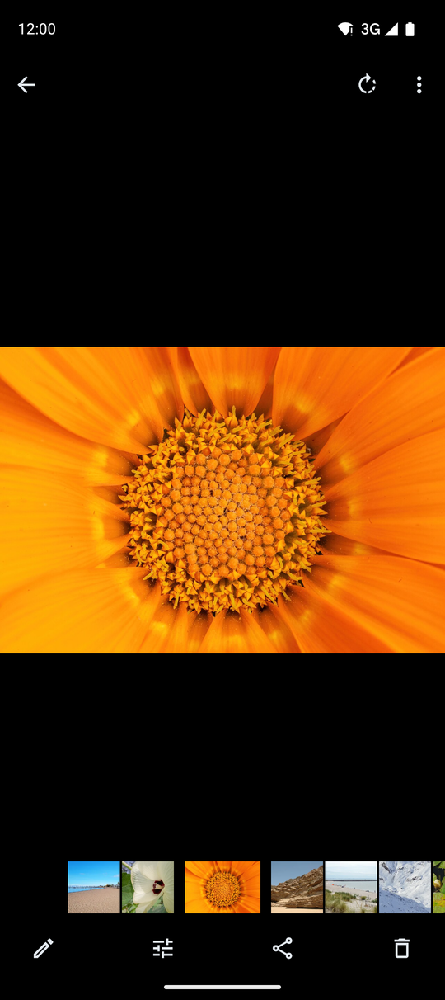
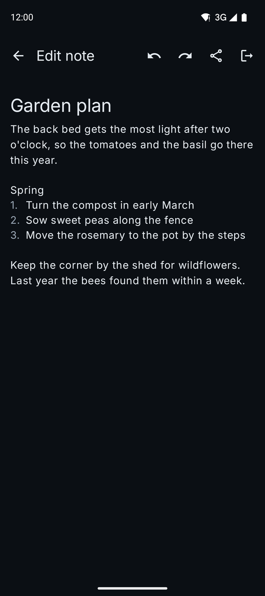
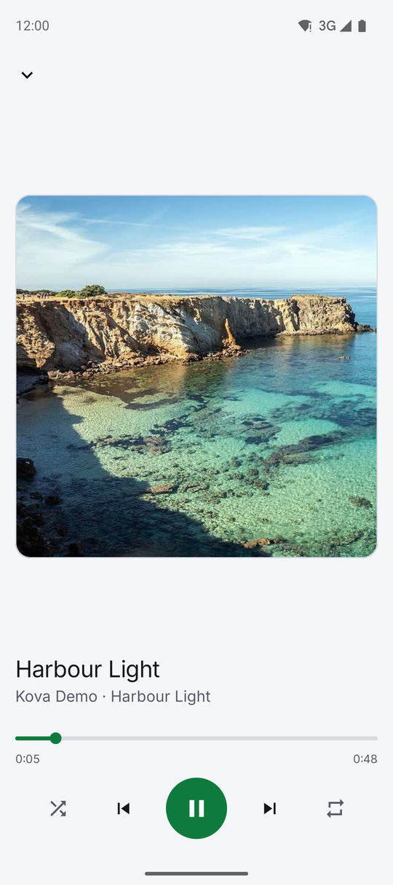
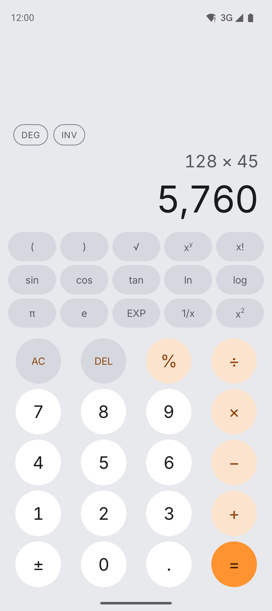
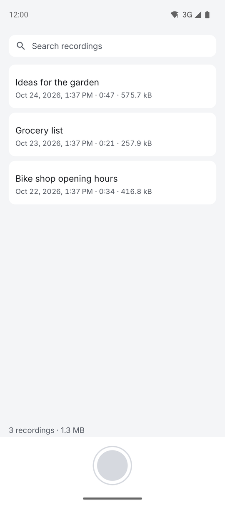
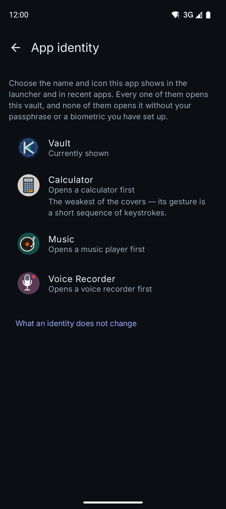

# Kova

**Private Vault**

Kova keeps your photos, videos, notes, voice memos and files in encrypted vaults on your Android phone. Everything is encrypted on the device with a key that only your passphrase, or the recovery kit you write down when you set it up, can open, and nothing ever leaves the phone unless you export or share it yourself. On the home screen it can look like a calculator, a music player or a voice recorder, and each of those is a working app of its kind.

## Screenshots

<table>
  <tr>
    <td></td>
    <td></td>
    <td></td>
    <td></td>
  </tr>
  <tr>
    <td></td>
    <td></td>
    <td></td>
    <td></td>
  </tr>
</table>

The photos are public-domain (CC0) images from Wikimedia Commons, and the music and memos were synthesised for these screenshots. Sources are listed in [`app/src/androidTest/assets/readme-demo/SOURCES.md`](app/src/androidTest/assets/readme-demo/SOURCES.md).

## Features

### Vaults and unlocking

- **Several vaults, one passphrase.** One passphrase opens your vault list. Any vault can also have its own passphrase, with its own recovery kit. Each vault gets a name, a colour and an icon.
- **24-word recovery kit.** You get it at setup, and you check three of its words before you go on, so you know it was written down. You can print it: the page says what it is for, how to use it and where to keep it. You can view it again from the menu up to three times. It recovers a forgotten passphrase and restores backups.
- **Extra Security.** On by default, and switched from the menu. If you open your vaults with your fingerprint, the app asks for your passphrase now and then so you don't forget it, and if you have forgotten it you can set a new one there and then. Every new recovery kit is followed by the three-word check.
- **Biometric unlock.** Fingerprint or face, on phones whose sensor meets Android's strong (Class 3) standard. It is a second way in, and your passphrase always works.
- **Face-down lock.** Turn the phone over and the vault locks, either at once or after a delay you choose.
- **What happened while you were away.** After you unlock, the vault lists failed unlock attempts, recovery-kit uses, and changes to the device since your last visit: root, developer options, the clock moving backwards, or the vault running on a different phone. The log is tamper-evident.
- **Screen protection.** The app blocks screenshots and screen recording. In recent apps it shows its cover, or its unlock screen, and never what is inside. The lock screen warns you if the phone is rooted, a debugger is attached, or an accessibility service can read the screen.

### What you can keep

- **Photos and videos.** Show them as a grid or a list, filter them, sort them and search them, and group them into coloured folders with covers. Play them as a slideshow. The video player has speed control, resume, repeat and double-tap to skip.
- **Image editor.** Crop, straighten, rotate, flip, filters, light adjustments and markup. Edits are saved as a new copy, so the original stays.
- **Files.** Any document, kept encrypted.
- **Notes.** Checklists, bulleted and numbered lists, headings, bold, italic and strikethrough, pinning, and attached images. An incognito-keyboard setting asks your keyboard not to learn from your notes.
- **Voice memos.** Recorded straight into the vault, with a choice of quality, stereo, a Bluetooth mic, and skip silence on playback.
- **Built-in camera.** Photos and video go straight into the vault and never touch the gallery.
- **Import from the gallery.** The app can remove the originals from the gallery afterwards, and can strip location and camera details as photos come in.
- **Trash.** Deleted items wait there for 30 days.

### Getting things out

- **Export and unvault.** Take out selected items or the whole vault. Each file is read back and checked before its encrypted copy is deleted.
- **Photo details.** Choose what is removed from photos before they leave the vault: location, camera info, date, or edit history.
- **Automatic backup.** Each vault backs up on its own, encrypted on the phone first, to a cloud app (as one sealed file) or to an SD card folder. Restoring takes the 24 words.
- **Moving to a new phone.** Save the vault as one encrypted `.vault` file and import it on the other device.
- **Secure sharing.** Send an encrypted file that only a paired contact's phone can open, or one that opens for anyone holding a four-word code. Pair with a contact by scanning each other's QR codes, or remotely with an invite file and four words. A share can open any number of times, once, or until it expires after 24 hours, 7 days or 30 days. Videos can be up to 60 seconds long.

### Protection from other people

- **Covers.** The app can appear on the home screen as a calculator (a scientific one), a music player (it plays the music on your phone) or a voice recorder (it records). The vault opens only through a gesture you set up on the cover: a button sequence, a 2-second hold on a spot you choose, a pattern, or a combination.
- **Intruder capture.** After a failed unlock, the app quietly takes a front-camera photo, an audio clip or a video. Each capture is sealed so only your passphrase opens it, and appears on a timeline.
- **Decoy vault.** A second vault with its own passphrase, filled with photos you choose and given dates and a history that look like months of normal use.
- **Panic credential.** A phrase that, typed at the lock screen, opens one vault list and shuts every other vault on the phone. It also empties your backup folder. Nothing on screen shows that it happened. The other vaults' files stay on the phone, and their recovery kits still open them. To set one up, you enter your passphrase and the phrase twice, and the app refuses a phrase too much like your passphrase.

### Everywhere

- **Offline only.** The app does not have Android's `INTERNET` permission, so it cannot open a network connection of its own. Backups go to a folder or cloud app you choose through Android's file picker, and on the Google Play version the purchase is handled by the Google Play Store app.
- **Nine languages.** English, German, Spanish, French, Brazilian Portuguese, Japanese, Korean, and Simplified and Traditional Chinese, chosen in the app separately from the phone's language.
- **Light, dark or system appearance.**

## Pricing

A copy you build yourself from this source is free and complete. It has no trial and no purchase, and nothing in it is ever locked.

The pre-built version on Google Play is for people who would rather not build it. It has a 30-day trial, which starts the first time you add something to a vault. After the trial, a one-time payment of **$8.99 USD** keeps adding to vaults, creating vaults and sending shares. There is no subscription.

In either version, opening, viewing and exporting everything in your vaults are never locked, and neither is opening a share someone sends you.

## Building from source

### What you need

- **JDK 21.** The build uses a Java 21 toolchain.
- **Android SDK** with **Platform 37** and a current **Build-Tools** package, which provides `apksigner`. Point the build at the SDK with `ANDROID_HOME`, or with `sdk.dir=/path/to/Android/Sdk` in a `local.properties` file at the project root.
- An Android phone running **Android 11 or later**.

You do not need to install Gradle. The wrapper in the repository downloads the version the project uses.

### Build

```sh
./gradlew :app:assembleGithubRelease
```

The APK is written to `app/build/outputs/apk/github/release/app-github-release-unsigned.apk`. It is unsigned, and Android will not install an unsigned APK.

### Sign it with your own key

Create a signing key once, and keep the keystore file and its password safe. An update installs over a copy only if both are signed with the same key.

```sh
keytool -genkeypair -v -keystore kova-release.jks -alias kova \
  -keyalg RSA -keysize 4096 -validity 10000
```

Then sign the APK. `apksigner` is in the SDK's `build-tools/<version>/` directory.

```sh
apksigner sign --ks kova-release.jks --ks-key-alias kova \
  --out kova.apk app/build/outputs/apk/github/release/app-github-release-unsigned.apk
apksigner verify kova.apk
```

### Install it

Turn on USB debugging on the phone, connect it, and run:

```sh
adb install kova.apk
```

A self-built copy has no trial and no purchase. Everything in it works from the first launch, for as long as you use it.

### Switching between the Play build and a self-build

The Play build and a self-built copy are signed with different keys, so Android will not install one over the other. You have to uninstall the one you have first, and uninstalling deletes every vault in it. Save your vaults before you uninstall.

1. Open each vault, open its menu, and choose **Unvault Everything**. Under "Moving to a new phone or another build?", enter the passphrase that opens your vault list and a new passphrase for the file, choose **Save encrypted archive**, and save the `.vault` file to Downloads. If a vault has automatic backup turned on, you can check its backup is up to date instead.
2. Uninstall the app, then install the other build.
3. On the welcome screen, choose **I have a backup or a .vault file**, then **Choose a file**, and pick the first `.vault` file. Enter the passphrase you chose for it, and finish setting up. That vault is the first one on your new vault list, with everything in it.
4. Bring back any other vaults from the vault list's menu, with **Import a vault from a file**.

It works the same way in both directions. Once everything is back, you can delete the `.vault` files from Downloads.

## Security

Kova derives its keys from your passphrase with Argon2id (64 MiB, 6 passes) and encrypts everything you keep with XChaCha20-Poly1305 through libsodium. Biometric unlock wraps the key with an AES-256-GCM key in the Android Keystore that needs a Class 3 biometric for every use. Shares to a paired contact use X-Wing, a post-quantum hybrid of ML-KEM-768 and X25519. [docs/security-design.md](docs/security-design.md) explains the keys, the file layout, the threat model and the known limits.

To report a vulnerability, see [SECURITY.md](SECURITY.md).

## Licence

Kova is source-available under the [PolyForm Strict License 1.0.0](LICENSE), with one added permission. You may read the source and build Kova for your own personal use on your own devices. You may not distribute it, in source or built form, change it or build new works from it, or sell it or use it for any commercial purpose. The third-party libraries and fonts it uses keep their own licences, and the app lists each one, with its full text, under Open-source licences in the menu.

## Work in progress

### Trademark policy

This section is in progress.

### Google Play

This section is in progress.

### Reproducible builds

This section is in progress.
# kova-private-vault-app
